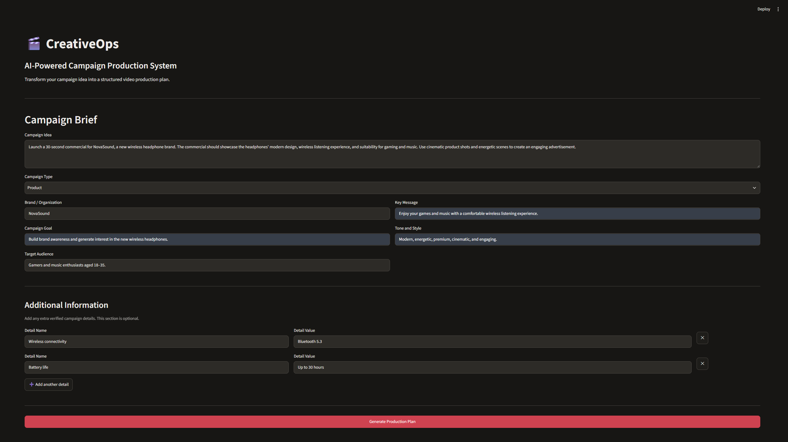
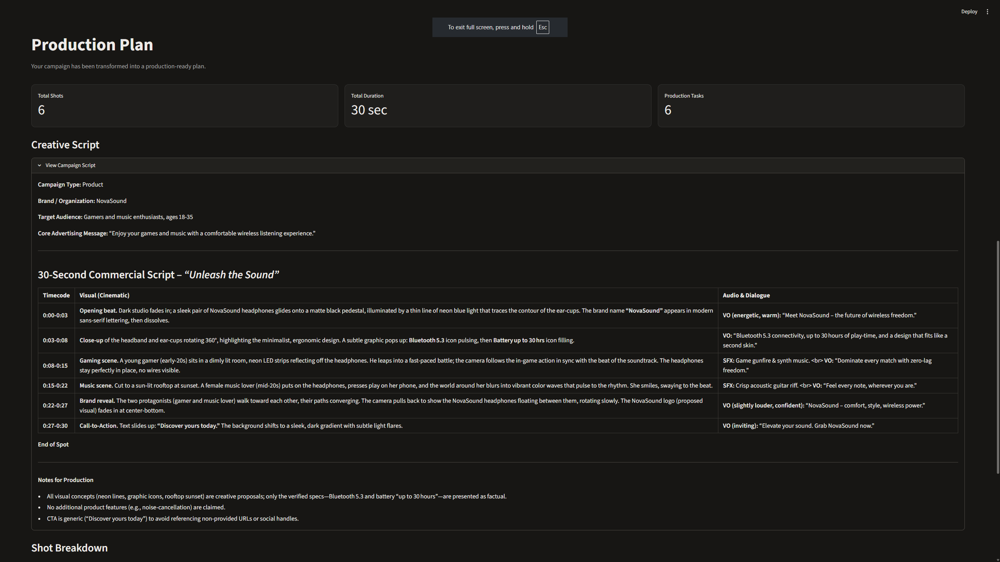
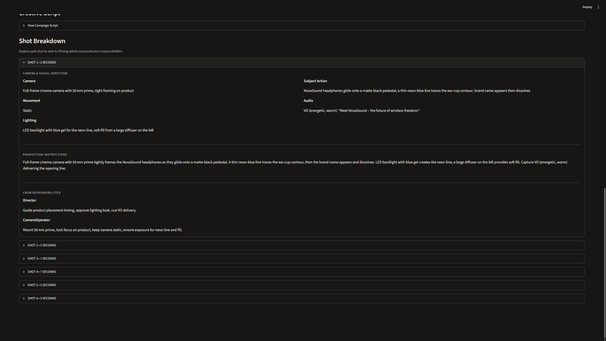
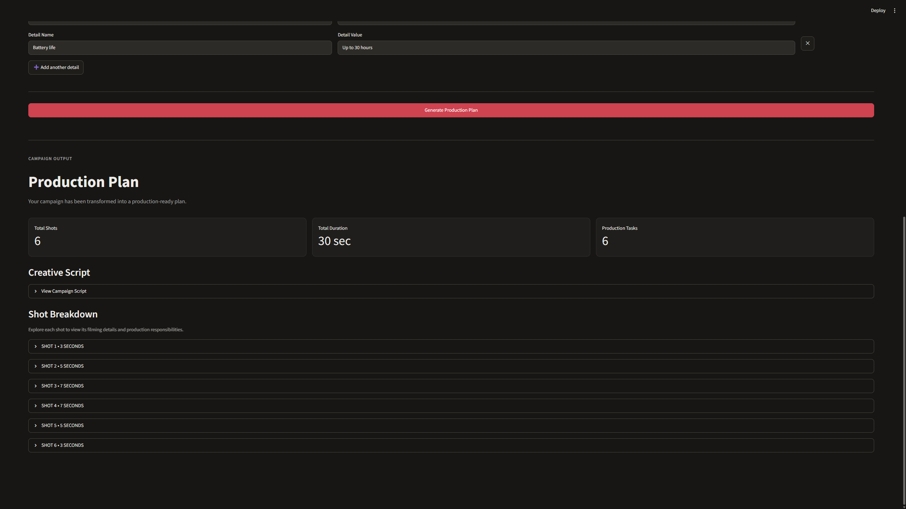
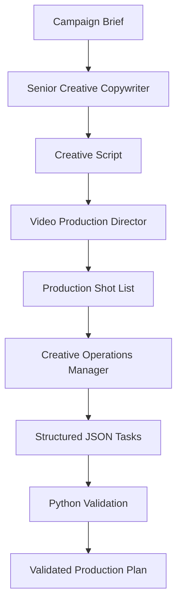

# CreativeOps Multi-Agent System

An AI-powered multi-agent system that transforms campaign briefs into structured 30-second video production plans.

Built with Python, CrewAI, Groq API, and Streamlit, the system uses three specialized AI agents to handle creative scripting, video production planning, and production task generation through a sequential workflow.

## Project Overview

CreativeOps automates the process of turning a campaign idea into an actionable video production plan.

Users provide a campaign brief through a simple web interface. The AI agents then collaborate to generate a creative commercial script, break it down into production shots, and organize the required production tasks.

##  Project Demo

Click the thumbnail below to watch the CreativeOps Multi-Agent System demonstration:

[](https://youtu.be/vuwTpalQD6I)

## Screenshots

### Campaign Input
Enter campaign details, objectives, target audience, key messages, and additional verified information.



### Generated Production Plan
View a summary of the generated production plan, including shot count, total duration, and production tasks.



### Shot Breakdown
Explore individual shots with camera direction, movement, lighting, subject actions, audio, and production instructions.



### Creative Campaign Script
Review the generated commercial script, including timecodes, visual descriptions, and voice-over or dialogue.



## Key Features

- **Multi-Agent Architecture:** Three specialized AI agents collaborate through a sequential workflow.
- **Creative Script Generation:** Produces structured 30-second commercial scripts.
- **Production Planning:** Converts creative scripts into detailed filming shot lists.
- **Task Generation:** Organizes production requirements into structured JSON tasks.
- **Context Passing:** Each agent uses the previous agent's output as context.
- **Automated Validation:** Checks JSON structure, required fields, task IDs, shot references, shot order, and duration consistency.
- **Interactive Web Interface:** A Streamlit interface for campaign input and viewing generated results.
- **JSON Export:** Saves validated production tasks to a JSON file.

## Multi-Agent Workflow

The system consists of three specialized agents:

1. **Senior Creative Copywriter**
   - Analyzes the campaign brief.
   - Develops the campaign concept and advertising message.
   - Generates a 30-second commercial script with visuals, timecodes, and audio.

2. **Video Production Director**
   - Transforms the creative script into a production shot list.
   - Defines camera specifications, movement, lighting, subject actions, and audio.
   - Focuses on practical and realistic production requirements.

3. **Creative Operations Manager**
   - Converts the production shot list into structured JSON tasks.
   - Assigns task IDs, shot references, durations, descriptions, and team responsibilities.

### Workflow Diagram



## Technologies Used

- **Python 3.12**
- **CrewAI** – Multi-agent orchestration and sequential workflows.
- **Groq API** – LLM inference using GPT-OSS-120B.
- **Streamlit** – Interactive web interface.
- **python-dotenv** – Environment variable management.
- **JSON** – Structured production task output.

## Project Structure

```text
CreativeOps Multi-Agent System/
│
├── app.py                  # Core application and agent workflows
├── ui.py                   # Streamlit user interface
├── requirements.txt        # Python dependencies
├── .env.example            # Environment variable template
├── .gitignore              # Files excluded from Git
├── README.md               # Project documentation
│
└── screenshots/
    ├── campaign-input.png
    ├── plan-overview.png
    ├── shot-details.png
    └── campaign-output.png
```

## Installation and Setup

### 1. Clone the Repository

```bash
git clone https://github.com/mohammdalankari/CreativeOps-Multi-Agent-System.git
cd "CreativeOps Multi-Agent System"
```

### 2. Create a Virtual Environment

```bash
python -m venv .venv
```

Activate it on Windows:

```powershell
.venv\Scripts\Activate.ps1
```

### 3. Install Dependencies

```bash
pip install -r requirements.txt
```

### 4. Configure Environment Variables

Create a `.env` file in the project root based on `.env.example`.

Add your Groq API key:

```env
GROQ_API_KEY=your_groq_api_key_here
```

**Important:** Never commit your `.env` file or expose your API key.

### 5. Run the Application

```bash
streamlit run ui.py
```

The application will open in your browser.

## Validation

The system includes automated Python validation to check:

- Valid JSON output.
- Required task fields and data types.
- Unique and correctly ordered task IDs.
- Valid shot references and matching shot order.
- Consistency between production shot durations and generated task durations.
- Exact 30-second total commercial duration, within the configured floating-point tolerance.

## Notes and Limitations

- This project is a functional prototype demonstrating a multi-agent creative operations workflow.
- Generated content depends on the campaign information provided and the AI model's output.
- Automated validation checks structural and timing consistency; it does not independently verify every factual or advertising claim.
- Running the system requires a valid Groq API key and an internet connection.

---

**Developed as an AI multi-agent automation project using Python and CrewAI.**
